# About this manual

This manual explains **what every screen, button and tool in RoboSim Studio does and how to use it**.
It grows together with the software: each feature is added here on the Day it is built and tested.

- **Software version covered:** v0.0.1 (Phase 0 — Foundation; first public release)
- **Last updated:** 2026-11-24 (Day 10)
- Features that are not built yet are listed under *Coming soon* and are not described in detail.

# 1. What is RoboSim Studio?

RoboSim Studio is a free, open-source robotics lab that runs in your web browser. When it is complete,
you will be able to design circuits, program Arduino, ESP32 and Raspberry Pi Pico boards, model sensors
and motors, tune controllers, simulate power electronics, drive robots in 2D and 3D, learn ROS 2, and
move simulated or real robots with your own hand gestures — with no installation and no licence fees.

It is organised into **10 labs** plus a learning platform:

| # | Lab | What it is for | Available from |
|---|---|---|---|
| 1 | Circuit Lab | Build and measure electronic circuits | v0.1 |
| 2 | Microcontroller Lab | Program Arduino and Raspberry Pi Pico boards | v0.2 |
| 3 | IoT Lab | ESP32 with Wi-Fi, MQTT and Bluetooth | v0.3 |
| 4 | Sensors & Actuators Lab | Realistic sensors, motors and drivers | v0.4 |
| 5 | 2D Robotics Lab | Mobile robots in 2D worlds | v0.5 |
| 6 | Control Systems Lab | PID, Bode plots, state-space control | v0.6 |
| 7 | Power Electronics Lab | Converters, solar MPPT, batteries | v0.6 |
| 8 | 3D Robotics Lab | Robot arms, rovers and drones in 3D | v0.7 |
| 9 | ROS Lab | ROS 2 concepts, navigation and SLAM | v0.8 |
| 10 | Gesture Control Lab | Move robots with hand and body gestures from a webcam | v0.9 |

# 2. Getting started

## 2.1 What you need

| Item | Requirement |
|---|---|
| Computer | Desktop or laptop (phones and tablets are not supported) |
| Memory | 8 GB RAM or more |
| Browser | Latest Chrome or Edge (recommended), Firefox or Safari |
| Screen | 1366 × 768 or larger, with keyboard and mouse or touchpad |
| Internet | Needed for the first load; loaded labs keep working offline |

## 2.2 Opening RoboSim Studio

The public website address will be added here when the first version is online (v0.0.1).

**During development (on the developer's computer):** open your browser and go to
`http://localhost:3100`.

# 3. Home page

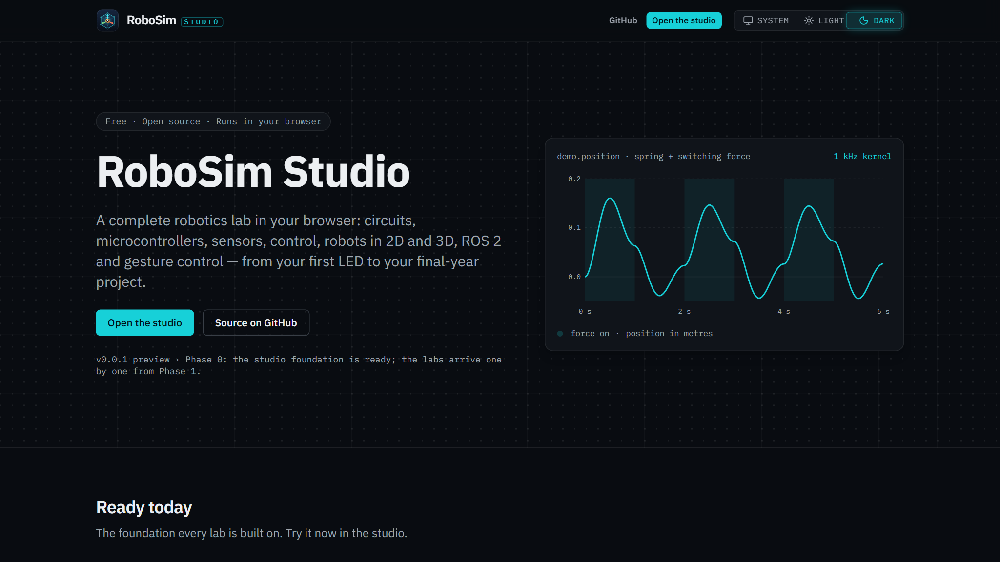

The home page is the first screen you see. It explains what RoboSim Studio is and takes you to the
studio.

| Part of the page | What it does |
|---|---|
| **Top bar** | The logo (a robot's coordinate frame and servo joint — also the icon in your browser tab), **GitHub** (the source code, in a new tab), **Open the studio** and the theme switch. |
| **Open the studio** | Opens the studio workspace (chapter 7). It appears three times on the page. |
| **Source on GitHub** | Opens the source code in a new tab. |
| **Chart** (right of the title) | A real result of the simulation kernel: the demo spring's position over 6 seconds (shaded: force on). It is calculated when the website is built. |
| **Ready today** | The six things that already work in the studio. |
| **The 10 labs** | The labs in release order, each with one line about what it will do and its phase. All are *planned*: they arrive one by one. |
| **Footer** | Software version, the MIT licence, the source code and the **UI kit** (the design preview page, chapters 4–6). |

# 4. Appearance: light and dark themes

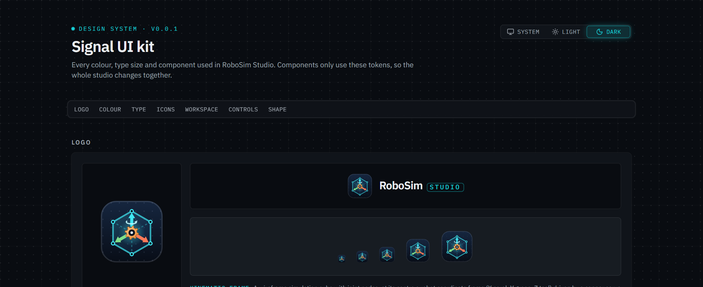

RoboSim Studio has a **dark** theme (the default — easier on the eyes during long sessions and it makes
circuits and plots stand out) and a **light** theme (good for classrooms, projectors and printing).

**How to change the theme**

1. Find the **SYSTEM · LIGHT · DARK** switch (top right of the page).
2. Click **LIGHT** or **DARK**. The whole page changes at once.
3. Click **SYSTEM** to follow your computer's own light/dark setting automatically.

| Option | What happens |
|---|---|
| **System** | Uses your operating system's setting and follows it if it changes. |
| **Light** | Light grey workspace with white panels. |
| **Dark** | Deep graphite workspace with a teal accent (default). |

- Your choice is **remembered** on this computer and browser, even after closing it.
- **Keyboard:** press **Tab** to reach the switch, then **←** / **→** to change the theme.

# 5. Entering values (engineering number fields)

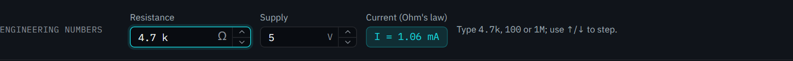

Wherever you set a value with a unit — resistance, voltage, frequency, capacitance — RoboSim Studio
uses an **engineering number field**. You can type values the way engineers write them.

**Typing a value**

1. Click in the field and type the value, e.g. `4.7k`.
2. Press **Enter** (or click somewhere else). The field shows it neatly as **4.7 k** and the unit (Ω).
3. Everything that depends on the value updates immediately (in the example, the current).

**SI prefixes you can type**

| Type | Means | Example | Value |
|---|---|---|---|
| `p` | pico, × 10⁻¹² | `22p` | 22 pF |
| `n` | nano, × 10⁻⁹ | `100n` | 100 nF |
| `u` or `µ` | micro, × 10⁻⁶ | `4.7u` | 4.7 µF |
| `m` | milli, × 10⁻³ | `20m` | 20 mA |
| `k` | kilo, × 10³ | `4.7k` | 4 700 Ω |
| `M` or `meg` | mega, × 10⁶ | `1M` | 1 000 000 Ω |
| `G` | giga, × 10⁹ | `2.4G` | 2.4 GHz |

Small **m** is milli and capital **M** is mega. Normal numbers (`220`, `3.3`) and scientific notation
(`2.2e-6`) also work.

**Keys**

| Key | Action |
|---|---|
| **↑** / **↓** | Increase / decrease by one step |
| **Shift** + **↑** / **↓** | Change by ten steps |
| **Enter** | Accept the typed value |
| **Esc** | Cancel typing and go back to the previous value |

The small **▲ / ▼** buttons on the right of the field do the same as the arrow keys.

**If you type something that is not a number** (for example `abc`), the field turns **red** and the
old value is kept, so a wrong entry can never break a simulation. Correct the text or press **Esc**.

# 6. The workspace: panels, toolbar and inspector

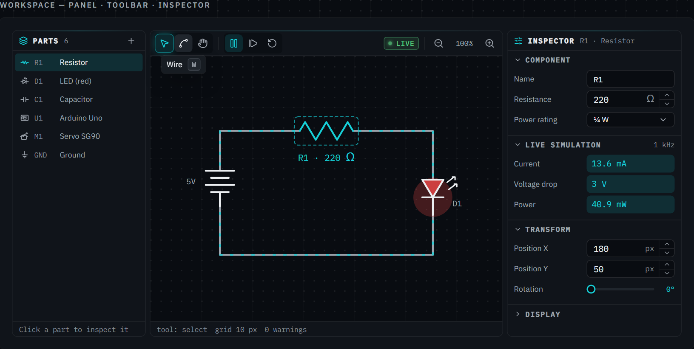

RoboSim Studio's labs are built from three kinds of building blocks. In v0.0.1 you can try them in a
small LED-circuit preview on the UI kit page (`/ui-kit` → **Workspace**). The studio itself is described
in chapter 7.

**Panels** are the boxes that hold each tool (parts list, inspector, oscilloscope…).

| Part of a panel | What it does |
|---|---|
| Title bar | Panel name in capitals, with an icon. A small grey number or text next to it gives extra info (e.g. how many parts). |
| Buttons on the right of the title bar | Actions for that panel, e.g. **+** to add a part. |
| Bottom line | Status of the panel, e.g. the current tool, grid size and number of warnings. |

**The toolbar** sits above the canvas.

| Control | What it does |
|---|---|
| **Select / Wire / Pan** (arrow, curve, hand) | Choose the mouse tool. Only one can be active; it lights up in teal. |
| **Run / Pause** (▶ / ⏸) | Start or pause the simulation. While running, the badge shows **LIVE** with a blinking light and current flows along the wires. |
| **Step** (▷|) | Advance the simulation by one step (when paused). |
| **Reset** (↺) | Return to the starting values. |
| **Zoom − / +** and the % value | Zoom the canvas out or in. |

- **Hover** over any tool to see its name and keyboard shortcut (e.g. **Wire W**).
- **Keyboard:** press **Tab** to enter the toolbar, then use **←** / **→** to move between tools and
  **Enter** to use one.

**The inspector** shows the properties of the selected part.

1. Click a part in the **Parts** panel or on the canvas — it is highlighted with a dashed teal frame.
2. Change its properties in the **Inspector** (name, value, rating, position, rotation, label).
3. Click a section title (**▸ COMPONENT**, **▸ TRANSFORM**…) to fold or unfold it.
4. The **Live simulation** section shows results in teal (current, voltage, power). If a value is
   dangerous — for example a resistor's power is above its rating — it turns **red** and the canvas
   status line shows a **warning**. This teaches the safe limits of real parts.

# 7. The studio workspace

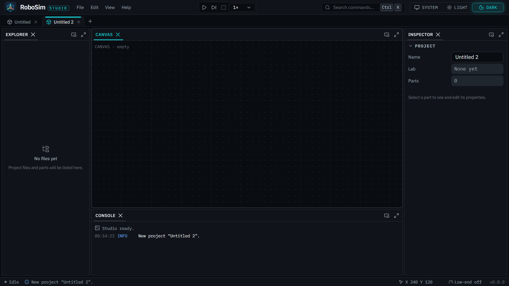

The studio is where you will build and simulate. Open it with **Open the studio** on the home page
(or go to `/studio`). The **Canvas** is a schematic editor where you draw circuits (chapter 8); the
other labs fill the panels in later versions. You can arrange the workspace the way you like.

## 7.1 Parts of the window

| Part | What it does |
|---|---|
| **Top bar** | Logo, the **File · Edit · View · Help** menus, the simulation buttons, **Search commands…** and the theme switch. |
| **Simulation controls** (▶ ⏭ ■ 1×) | Run / Pause, Step, Stop and the simulation speed (see 7.6). |
| **Project tabs** | One tab per open project. **+** adds a new one. |
| **Explorer** and **Parts** (left, two tabs) | Explorer will list your project's files. **Parts** is the parts library: search it and place parts on the canvas (8.2). |
| **Canvas** (middle) | The schematic: place, select and arrange circuit parts on a grid (chapter 8). |
| **Console** (under the canvas) | A log of everything the studio tells you, with the time. |
| **Inspector** (right) | Shows the selected part with all its properties (8.4) and its live voltage, current and power (8.9), a wire's net, a net label, and the open project (name, lab, parts). |
| **Status bar** (bottom) | State, latest message, pointer position, Low-end mode and version. |

## 7.2 Arranging panels

Every panel has a **tab** (its name in capitals) and two buttons on the right of its title row.

| To… | Do this |
|---|---|
| Put two panels in one place as tabs | Drag a tab onto another panel's tab row. |
| Split a panel | Drag a tab onto the **edge** of another panel. A teal area shows where it will land. |
| Resize | Drag the thin gap between two panels. It lights up teal while you drag. |
| Float a panel as a window | Click the **window** button (▭) in its title row. Drag the window by its top strip. |
| Put a floating panel back | Click the **dock** button in the floating window's title row. |
| Fill the whole workspace with one panel | Click the **expand** button (⤢). Click it again to restore. |
| Close a panel | Click the **×** on its tab. |
| More options | **Right-click** a tab: Close, Close others, Close all, Float, Maximize. |

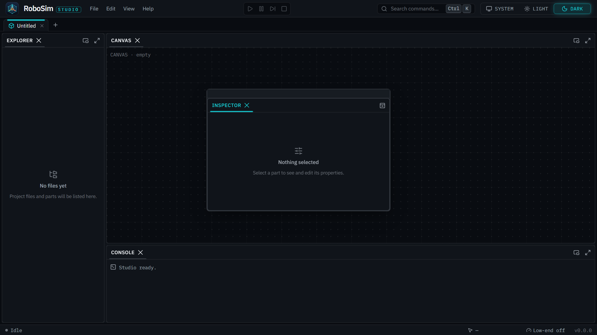

**Show or hide panels** with the **View** menu: a tick means the panel is open. A closed panel comes
back in its usual place.

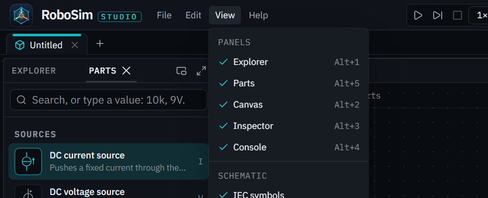

**Your layout is saved.** The studio remembers how you arranged the panels on this computer and
browser and restores it next time. If the saved layout cannot be used, the studio opens the default
layout and says so in the status bar. To go back to the default at any time, choose
**View → Reset layout**.

## 7.3 Projects

- **New project:** click **+** next to the tabs, or **File → New project**. Projects are named
  *Untitled*, *Untitled 2*, … (up to 12 at once).
- **Switch:** click a tab, or use **←** / **→** when a tab has keyboard focus.
- **Close:** click the **×** on a tab, press **Delete** while a tab has keyboard focus, or use
  **File → Close project**. The next tab opens.
- With no project open, the workspace shows **New project** and **Recent projects**.

Projects are saved automatically (see 7.5). They have no parts yet — parts arrive with the labs.

## 7.4 Project name and Undo / Redo

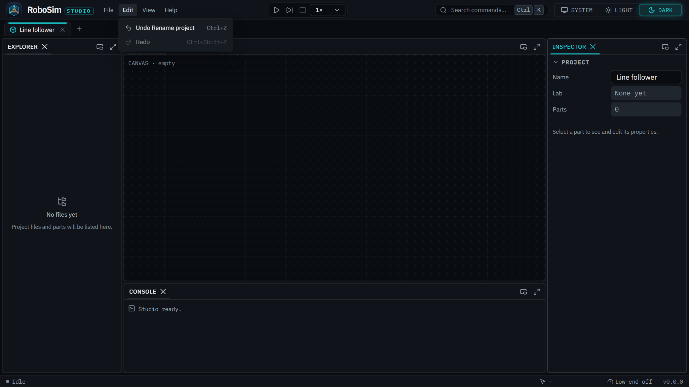

When no part is selected, the **Inspector** shows the **Project** section:

| Row | What it does |
|---|---|
| **Name** | The project's name. Click it, type a new name and press **Enter** (or click elsewhere). The project tab shows the new name. **Esc** cancels your typing. A name must have 1–100 characters. |
| **Lab** | The lab the project belongs to (*None yet* until labs arrive). |
| **Parts** | How many parts the project has. |

**Undo and Redo.** Every change to a project can be undone:

- **Undo:** press **Ctrl + Z** or choose **Edit → Undo**. The menu says what will be undone, for
  example **Undo Rename project**, and the status bar confirms it (*Undo: Rename project.*).
- **Redo:** press **Ctrl + Y** or **Ctrl + Shift + Z**, or choose **Edit → Redo**.
- When there is nothing to undo (or redo), the menu item is greyed out.
- Each project tab has its **own** undo history: Undo never changes another project.
- The studio remembers the last 200 changes of each project.
- Inside a text box (such as the project name while you type), **Ctrl + Z** undoes your typing, not
  the project.

## 7.5 Saving, files and sharing

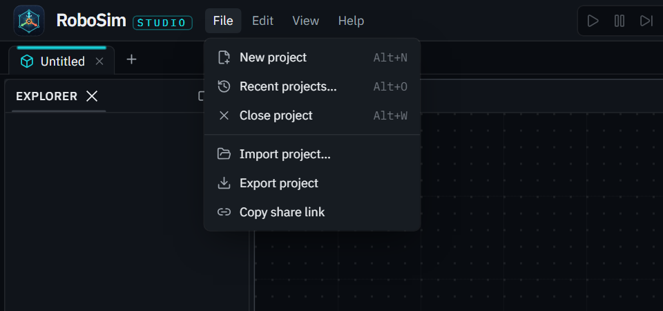

**Automatic saving.** You never need to press Save. Every change is saved in your browser about one
second after you make it, and also when you close or reload the page. When you open the studio again,
the same project tabs come back, with the same tab active. (Undo history starts fresh after a reload.)

> Projects are stored **in this browser on this computer only**. Clearing the browser's site data
> deletes them, and another browser or computer does not see them. To keep a backup or move a
> project, **export** it (below). If the browser does not allow saving (for example in some private
> windows), the status bar says *Your projects are not being saved.*

**Recent projects.** Choose **File → Recent projects…** (or press **Alt + O**) to see every project
saved in this browser, newest first, with its lab, number of parts and when it last changed.

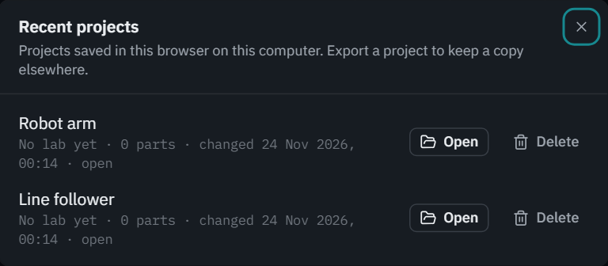

| Button | What it does |
|---|---|
| **Open** | Opens the project in a new tab (or switches to its tab if it is already open). |
| **Delete** | Click once: the button turns red and says **Delete for good?** Click again to delete the project from this browser. If it is open, its tab closes. This cannot be undone — export the project first if you may need it again. |

**Export and import (.rsim files).** A `.rsim` file contains one whole project.

- **File → Export project** downloads the active project, for example `line-follower.rsim`.
- **File → Import project…** opens a `.rsim` file as a **new** project tab. It never replaces a
  project you already have, even one with the same name.
- Files that are not RoboSim Studio projects, are damaged, larger than 10 MB, or come from a newer
  version of RoboSim Studio are refused, and the status bar says why.

**Share links.** **File → Copy share link** copies a link to the clipboard. Anyone who opens it gets
their own **copy** of the project in their browser.

- The project is packed inside the link itself (after `#share=`). It is **not uploaded anywhere**.
- Only small projects fit in a link. For a larger one the studio says so — send a `.rsim` file
  instead.
- Opening a share link adds the project as a new tab and then removes the link from the address bar,
  so reloading does not add it twice. A damaged link is refused with a message.

## 7.6 Running a simulation

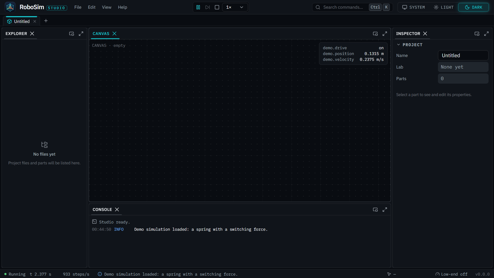

Until the first lab arrives, the studio runs a small **demo simulation**: a weight on a spring with
a damper, pushed by a force that switches on and off every second. It shows how every simulation in
RoboSim Studio will be controlled.

| Control | What it does |
|---|---|
| **▶ Run** | Starts the simulation, or continues it after a pause. While it runs, the button becomes **⏸ Pause**. Keys: **Ctrl + Enter** (run / pause). |
| **⏭ Step** | Moves the simulation forward by one step of **1 ms**, then stops. Use it to look at what happens step by step. Works when the simulation is paused or stopped. Keys: **Alt + .** |
| **■ Stop** | Stops and goes back to **0 s**: everything starts again from the beginning. Keys: **Ctrl + Shift + Enter**. |
| **Speed** (1×) | How fast simulated time runs compared with real time: from **0.1×** (ten times slower, to watch fast events) to **10×** (ten times faster). |

While a simulation is loaded:

- The **status bar** shows its state (**Idle**, **Running**, **Paused**), the simulated time (for
  example *t 2.919 s*) and, while running, how many steps per second the computer manages (about
  **1000 steps/s** at 1×).
- The **canvas** shows the live values in its top-right corner — here the force (*on* / *off*), the
  position (m) and the speed (m/s) of the weight.
- If your computer cannot keep up, the status bar shows **⚠ Behind**: the simulation then runs slower
  than real time instead of freezing the studio. Lower the speed or close other programs.

> The simulation runs in the background (in its own *worker*), so the studio stays smooth while it
> runs: you can move panels, edit and type as usual.

## 7.7 Status bar and Low-end mode

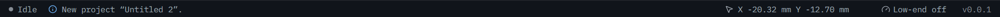

| Part | What it shows |
|---|---|
| **Idle / Running / Paused** | Simulation state, with the simulated time and steps per second (see 7.6). |
| Message | The latest message, e.g. *Saved layout restored.* All messages are in the **Console**. |
| **X … Y …** | Mouse pointer position on the schematic grid, in millimetres or inches (**View → Schematic**). |
| **Low-end off / on** | Click to switch **Low-end mode** (below). **· auto** means the studio switched it on by itself for this computer; point at the button to see why. |
| **v0.0.1** | Software version. |

**Low-end mode** makes the studio lighter for slower computers: animations are off, the numbers in
the status bar and on the canvas update less often, and the simulation sends fewer updates (later,
3D views will also use fewer pixels and no shadows). Your choice is remembered.

The studio switches Low-end mode on **by itself** when the computer has 4 GB of memory or less, 2
processor cores or fewer, no WebGL2 3D graphics, or draws graphics without a graphics card. It
then says why once in the Console. If you switch it on or off yourself, your choice wins.

**System information** (**Help → System information**) shows what the studio found out about your
computer and whether Low-end mode is recommended, with a button to switch it. This information is
used only on your computer and is never sent anywhere.

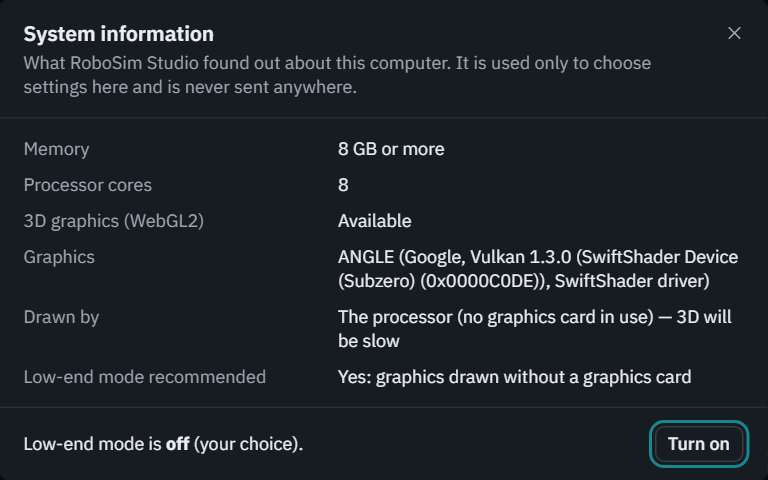

| Row | What it shows |
|---|---|
| **Memory**, **Processor cores** | As reported by the browser (browsers report at most "8 GB"). |
| **3D graphics (WebGL2)** | Whether 3D views can work on this computer. |
| **Graphics**, **Drawn by** | The graphics chip, and whether a graphics card or the processor draws the 3D views. Some browsers (for example Brave and Safari) hide the chip for privacy: then it says *Hidden by the browser*. |
| **Low-end mode recommended** | *No*, or *Yes* with the reasons. |

## 7.8 Command palette

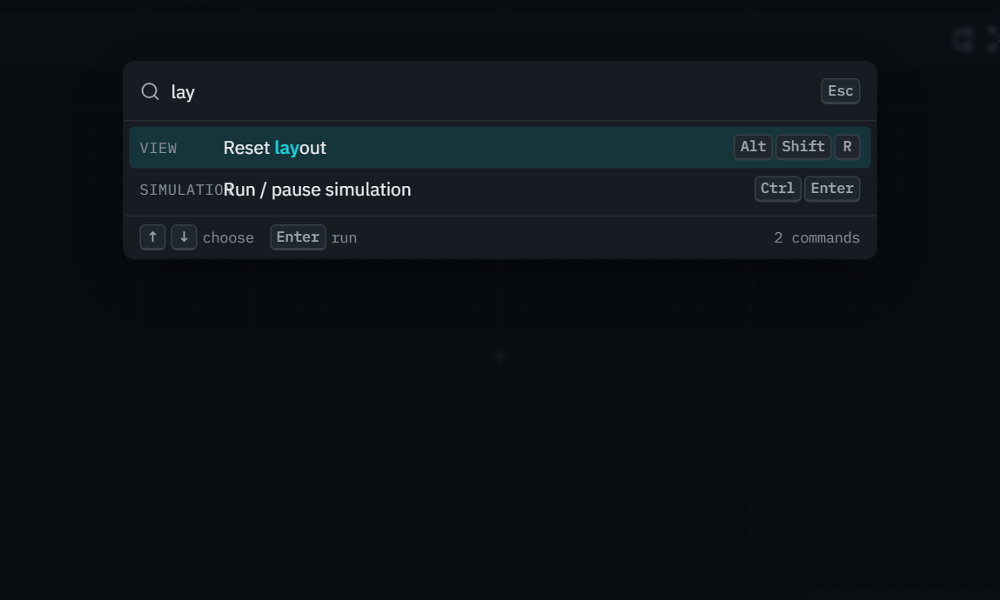

Every action in the studio can be found and run from one search box.

1. Press **Ctrl + K** (**⌘ + K** on a Mac) or click **Search commands…** in the top bar.
2. Type a few letters — for example `lay` finds **Reset layout**. Matching letters light up in teal.
3. Use **↑** / **↓** to choose and **Enter** to run, or click a command. **Esc** closes the palette.

- Commands you used recently are listed first.
- A command that cannot run right now (for example *Next project tab* with only one project) is shown
  dimmed.
- The keys on the right of a command are its keyboard shortcut.

## 7.9 Keyboard shortcuts

Press **Ctrl + /** or **?** (or **Help → Keyboard shortcuts**) to see this list in the studio.

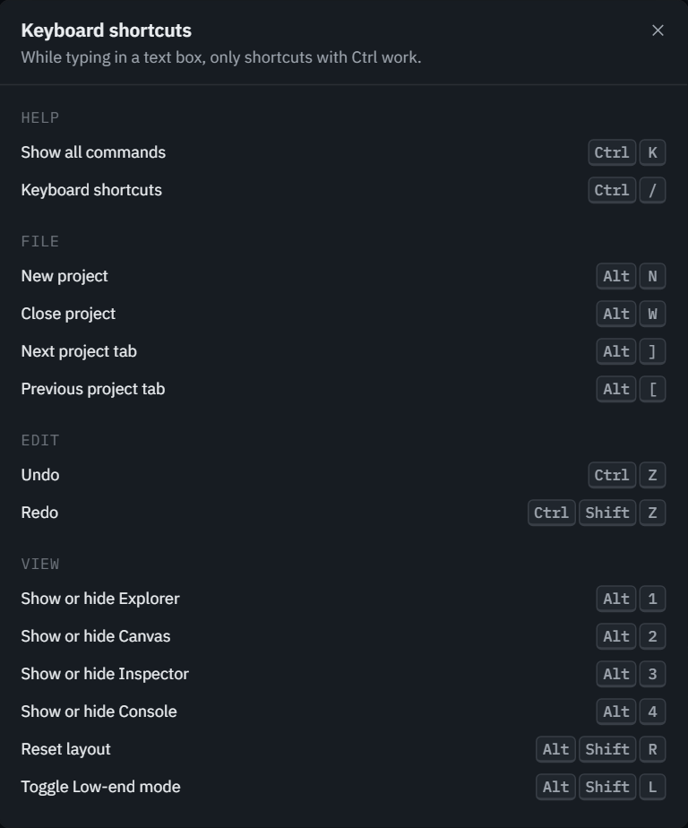

| Keys | Action |
|---|---|
| **Ctrl + K** | Command palette (open / close) |
| **Delete** (on a project tab) | Close that project |
| **Ctrl + /** or **?** | Keyboard shortcuts window |
| **Ctrl + Z** | Undo |
| **Ctrl + Y** or **Ctrl + Shift + Z** | Redo |
| **Ctrl + Enter** | Run / pause the simulation |
| **Alt + .** | Step the simulation (1 ms) |
| **Ctrl + Shift + Enter** | Stop the simulation (back to 0 s) |
| **Alt + N** | New project |
| **Alt + O** | Recent projects |
| **Alt + W** | Close project |
| **Alt + ]** / **Alt + [** | Next / previous project tab |
| **Alt + 1 … 4** | Show or hide Explorer, Canvas, Inspector, Console |
| **Alt + 5** | Show or hide the Parts panel |
| **Alt + Shift + R** | Reset layout |
| **Alt + Shift + L** | Low-end mode on / off |
| **A**, **W**, **L**, **F**, **+**, **−**, **R**, **X**, **Y**, arrows, **Delete**, **Ctrl + A** (on the canvas) | Schematic keys — see chapter 8 |

- On a Mac use **⌘** instead of **Ctrl** and **⌥ Option** instead of **Alt**.
- While you type in a text box (such as the palette search), only **Ctrl** shortcuts work, so your
  typing is never interrupted. **Ctrl + Z** and **Ctrl + Y** then undo and redo your typing.
- The browser keeps some keys for itself (Ctrl + N, Ctrl + W, Ctrl + Tab…), so the studio uses
  **Alt** for those actions instead.

# 8. Drawing a schematic

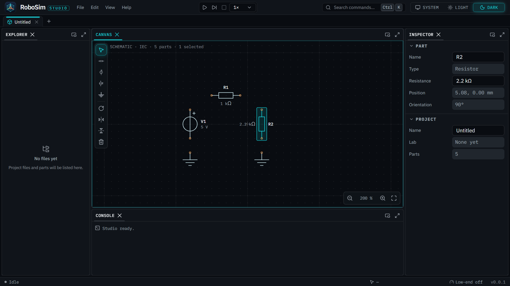

The **Canvas** is a schematic editor that works like professional circuit software. Parts sit on a
grid of **2.54 mm (0.1 inch)** — the standard spacing of component pins — so their connection points
always line up. Parts come from the **Parts** panel (8.2); wires and net labels connect them
(8.6–8.8).

The **tool palette** on the left of the canvas has, from the top: **Select** (Esc), **Wire** (W),
**Net label** (L) and **Add part** (A), then **Rotate**, **Mirror left–right**, **Mirror top–bottom**
and **Delete** for the selection.

## 8.1 Moving around: zoom and pan

| Do this | To |
|---|---|
| Turn the **mouse wheel** | Zoom in or out around the mouse pointer (10 % to 3 200 %) |
| Drag with the **middle mouse button**, or hold **Space** and drag | Pan (move the view) |
| **Shift** + mouse wheel | Pan left and right |
| Press **F** (or **Home**), or click **⛶** in the zoom bar | Zoom to fit the whole drawing |
| Press **+** / **−**, or click the zoom bar buttons | Zoom one step in or out |
| Click the **%** value in the zoom bar | Go back to 100 % (real size) |

The small cross on the grid is the origin (0, 0). The status bar shows where the pointer is on the
grid, in millimetres or inches.

## 8.2 The parts library and placing parts

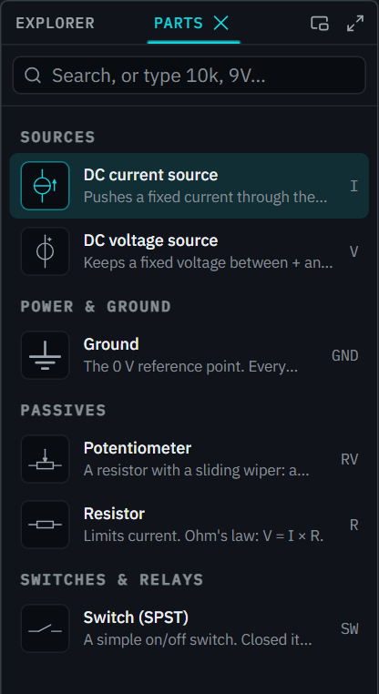

The **Parts** panel (the tab beside Explorer; **View → Parts** or **Alt + 5**) lists every part,
grouped like a component catalogue, each with a small drawing of its symbol, one line about what it
does, and its name prefix (R, V, SW…).

| Part | Name | What it is | You can set |
|---|---|---|---|
| DC voltage source | V1, V2… | A fixed voltage between + and −, like an ideal battery | Voltage |
| DC current source | I1… | A fixed current, whatever the voltage | Current |
| Ground | GND1… | The 0 V reference; every circuit needs one | — |
| Resistor | R1… | Limits current (V = I × R) | Resistance, tolerance, power rating |
| Potentiometer | RV1… | A resistor with a sliding wiper (a turnable voltage divider) | Resistance, wiper position (0–100 %) |
| Switch (SPST) | SW1… | An on/off switch; open by default | Closed (on / off) |

**Search.** Type in the box at the top: the list filters as you type — by name (`resistor`), short
word (`pot`, `gnd`, `battery`, `toggle`) or prefix (`sw`). Every word must match.

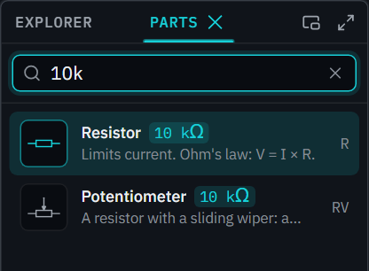

**Search by value.** Type a value the way it is printed on parts — `10k`, `4k7`, `220R`, `9V`,
`2mA` — and the parts that can have it are shown with the value in a teal tag. The part you place
then starts with that value. A number with a prefix and no unit (`10k`) means ohms.

**Placing a part** — three ways:

1. **Click** a part in the list, or choose it with **↑** / **↓** and press **Enter**. The canvas
   switches to placing it: a teal outline follows the pointer and snaps to the grid.
   - **R** turns it 90° (**Shift + R** the other way), **X** mirrors it left–right, **Y** top–bottom.
   - Click to place it. You stay in the tool, so you can place more of the same part.
   - **Esc** or right-click (or the arrow tool) stops placing.
2. **Drag** a part from the list onto the canvas. A teal outline shows where it will land; let go to
   place it. The new part is selected, ready to move or edit.
3. On the canvas, press **A** (or click **Add part** in the tool palette): the cursor jumps to the
   parts search. Type, press **Enter**, click to place.

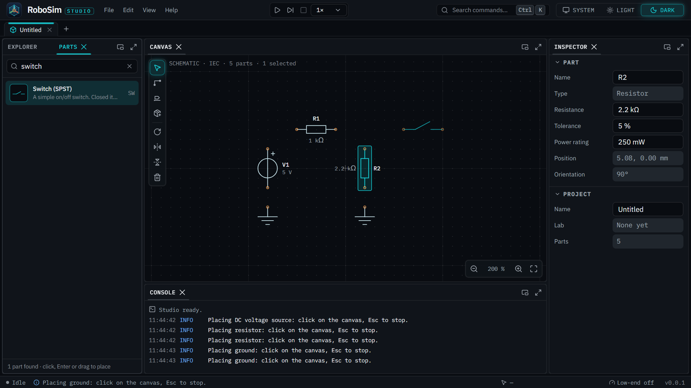

While you place a part, the **Add part** button shows that part's symbol. **Esc** in the search box
clears it. The parts you placed last are listed first under **Recently used**.

Every part gets the next free name automatically — **R1**, **R2**, … **V1**, **I1**, **SW1**,
**GND1** — and a sensible starting value (for example 1 kΩ, 5 V, 1 mA, 10 kΩ at 50 %).

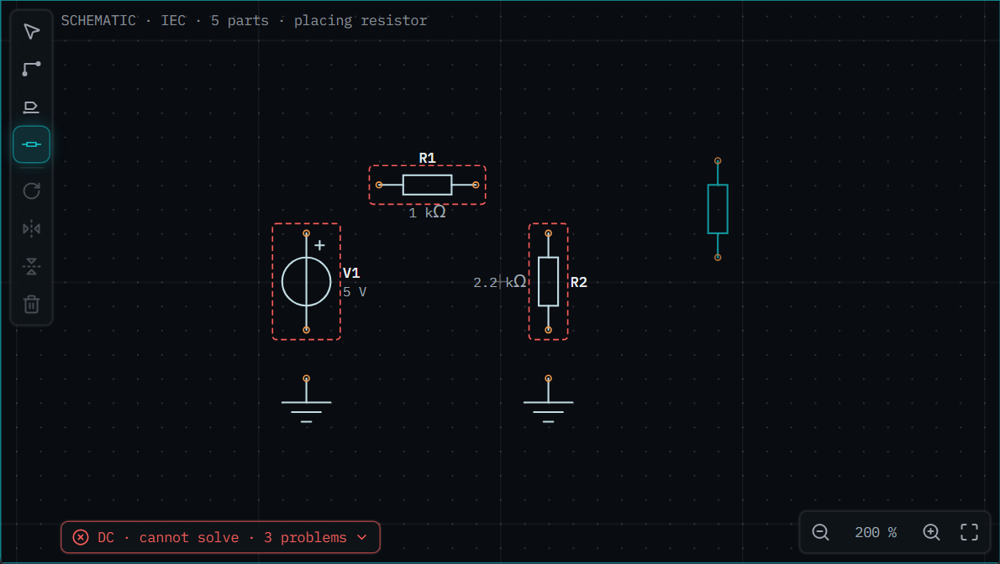

## 8.3 Selecting and editing

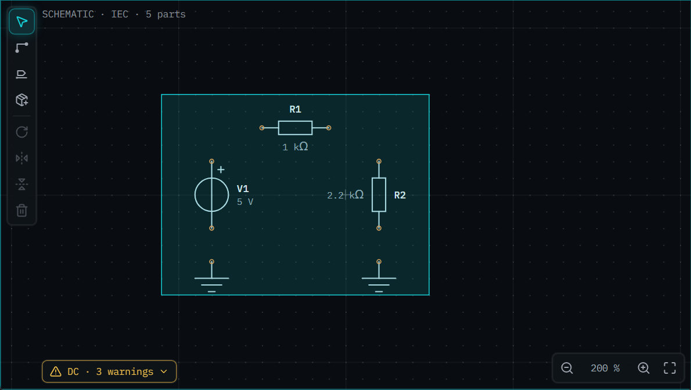

| Do this | To |
|---|---|
| Click a part | Select it (it turns teal with a soft box around it). Wires and labels are selected the same way (8.7). |
| **Shift** + click | Add a part to the selection |
| **Ctrl** + click | Add or remove one part |
| Drag on empty canvas **from left to right** | Select the parts **fully inside** the box (solid outline) |
| Drag on empty canvas **from right to left** | Select every part the box **touches** (dashed outline) |
| **Ctrl + A** | Select everything |
| **Esc**, or click empty canvas | Select nothing |
| Drag a selected part | Move the selection, by whole grid steps |
| **Arrow keys** | Move the selection one grid step (**Shift** + arrow: ten steps) |
| **R** / **Shift + R** | Rotate the selection 90° clockwise / counter-clockwise |
| **X** / **Y** | Mirror the selection left–right / top–bottom |
| **Delete** (or **Backspace**) | Delete the selection |

The **rotate**, **mirror** and **delete** buttons at the bottom of the tool palette do the same. A
group of parts turns and mirrors around its middle, keeping its layout. Every change is one step
for **Undo** (**Ctrl + Z**) — the Edit menu says what will be undone, for example *Undo Move 2 parts*.

## 8.4 Changing parts in the Inspector

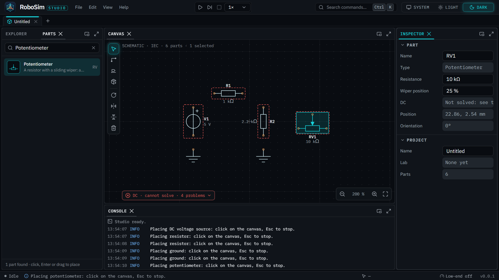

Select one part and the Inspector shows **every property of that part**:

| Row | What you can do |
|---|---|
| **Name** | Rename the part (it must start with a letter, for example `R_load`). |
| **Type** | What kind of part it is (point at it to read what the part does). |
| **Numbers** (Resistance, Voltage, Current, Tolerance, Power rating, Wiper position…) | Type a new value and press **Enter**. Write it the way it is printed on parts: `4.7k`, `4k7`, `4.7 kΩ`, `220R`, `100n`, `500 mV`, `25 %`. Point at the row's name to see the allowed range. A value that is not possible (for example `0` Ω or a wiper at `150 %`) is refused with a message in the status bar, and the old value stays. |
| **On / off** (the switch's **Closed**) | Click the switch control. The symbol on the canvas changes: a closed switch is drawn closed. |
| **Position**, **Orientation** | Where the part is (from the origin) and how it is turned and mirrored. |

**Esc** in a field puts the old value back. Every change is one step for **Undo**.

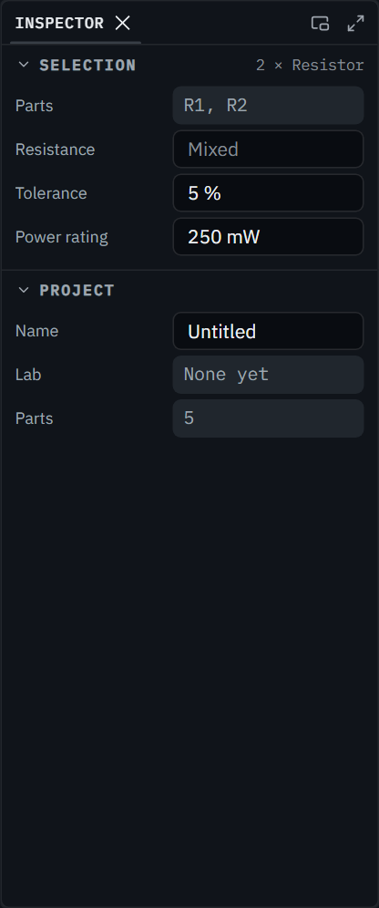

**Several parts at once.** Select two or more parts **of the same type** (for example all
resistors): the Inspector shows *Selection · 2 × Resistor* and the same rows. A row whose values
differ says **Mixed**. Type a value and press **Enter** to give it to all of them — one step for
Undo (*Undo Set resistance of 2 parts*). With different kinds of parts selected, the Inspector shows
how many of each.

## 8.5 Symbol style and units

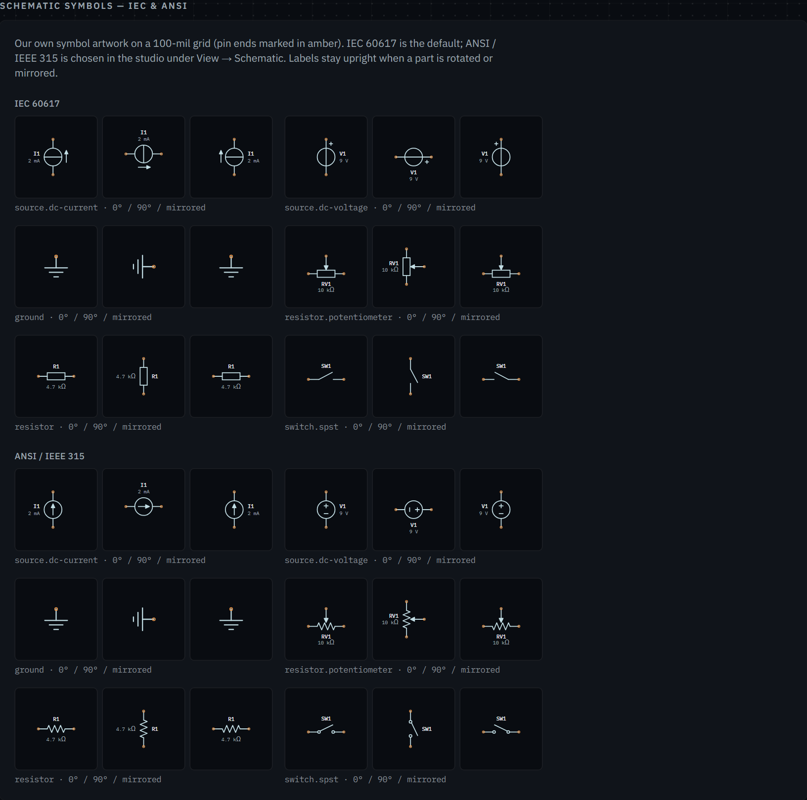

**View → Schematic** chooses:

- **IEC symbols** (default; box resistor, used in Europe, Asia and most textbooks) or **ANSI
  symbols** (zig-zag resistor, used in the USA).
- **Units: millimetres** or **Units: inches** for the pointer position and the Inspector.

Your choice is remembered in this browser. Part names and values always stay upright and readable,
however a part is turned.

## 8.6 Connecting parts with wires

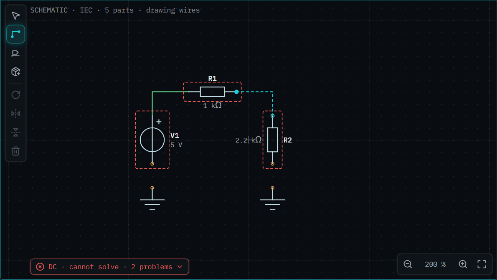

1. Press **W**, or click **Wire** (second button of the tool palette).
2. Click on a part's **pin end** (the small orange circle) to start the wire.
3. Move the mouse: a dashed **L-shaped** preview follows the pointer. Press **/** to switch it between
   *across first* and *down first*.
4. Click on empty grid to fix a **corner**, as many times as you need.
5. Click on another **pin** or on another **wire**: the wire ends there by itself. To end it anywhere
   else, **double-click** or press **Enter**.
6. You stay in the wire tool for the next wire. **Esc** drops the wire you are drawing; a second
   **Esc** goes back to the arrow tool.

| Key | While drawing a wire |
|---|---|
| **Backspace** | Remove the last corner you clicked |
| **/** | Switch the corner direction |
| **Enter** or double-click | End the wire here |
| **Esc** or right-click | Drop this wire |

**What is connected, and what is not** (the same rules as professional circuit software):

- A wire is connected where one of its **ends** touches a pin, the end of another wire, or the middle
  of another wire. Where three or more connections meet, a **dot** is drawn.
- Two wires that only **cross** are **not** connected (no dot). A wire that only passes over a pin is
  not connected either.
- A connected pin loses its small circle, so open (unconnected) pins are easy to see.

## 8.7 Moving and editing wires

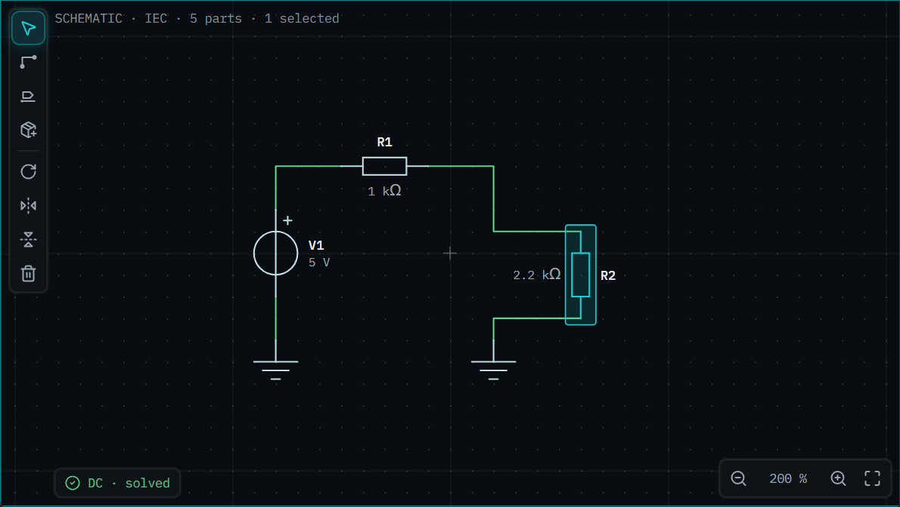

- **Wires follow the parts.** Drag a part, turn it (**R**) or mirror it (**X** / **Y**): the wires
  connected to it stretch and add a corner where needed, so nothing comes loose. You see this live
  while you drag.
- **Select a wire** with the arrow tool: click it (it turns teal), **Shift** / **Ctrl** + click to add
  more, or drag a selection box: wires, parts and labels are selected together. **Ctrl + A** selects
  everything.
- A selected wire **moves** with the arrow keys or by dragging, and **Delete** removes it. Moving a
  wire on its own takes it off its pins; move it together with its parts to keep everything connected.
- As always, every change is one step for **Undo** (**Ctrl + Z**), for example *Undo Delete 1 wire*.

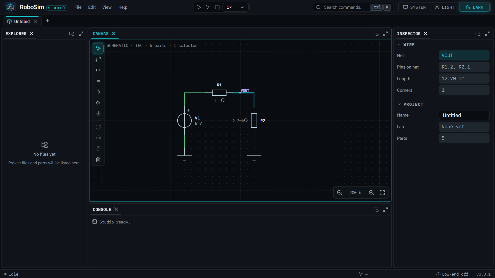

Select **one wire** and the Inspector shows:

| Row | Meaning |
|---|---|
| **Net** | The name of the connection the wire belongs to: a label name (here **VOUT**), **GND**, or a name made from the first pin, for example `N_V1_+`. *Not connected* means the wire touches no pin. |
| **Pins on net** | Every pin on this connection, written *part.pin*, for example `R1.2` (pin 2 of R1) or `V1.+`. |
| **Length**, **Corners** | Size and shape of the wire. |

## 8.8 Net labels, copy and paste

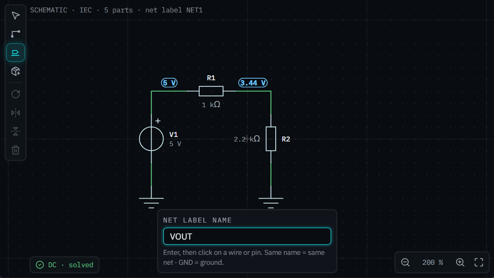

A **net label** gives a connection a name. **All labels with the same name are connected**, even when
no wire joins them, which keeps big drawings tidy. A label named **GND** connects to ground.

1. Press **L**, or click **Net label** (third button of the tool palette).
2. Type the name (1–32 letters, digits or `_ + . -`, for example `VOUT`, `SDA`, `5V`) and press **Enter**.
3. Click on a wire or a pin end to place the label there. You can place more: a name ending in a
   number counts up by itself (`D0`, `D1`, `D2`…).
4. **R** turns the next label (for vertical wires). **N** asks for a new name. **Esc** stops.

A label is selected, moved, turned (**R**) and deleted like a part. Select one label and the Inspector
lets you **rename** it and shows how many labels share its name.

**Copy, cut, paste and duplicate** work on everything you select (parts, wires and labels):

| Keys | Does |
|---|---|
| **Ctrl + C** | Copy |
| **Ctrl + X** | Cut (copy, then delete) |
| **Ctrl + V** | Paste at the mouse pointer |
| **Ctrl + D** | Duplicate next to the original |

Pasted parts get new free names (if R1 and R2 exist, a copied R1 becomes R3), and the pasted items are
selected so you can move them straight away. You can copy between project tabs and browser windows.
The studio only pastes RoboSim drawings: anything else on the clipboard is ignored with a message, and
nothing from the clipboard is used without being checked.

## 8.9 Live DC results: voltages, currents and power

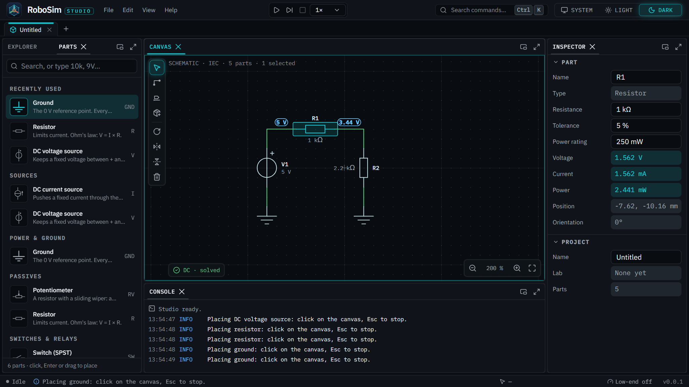

RoboSim Studio **solves your circuit while you draw**. A moment after every change, it works out the
**DC operating point**: the steady voltage at every point of the circuit and the current through
every part, like a multimeter on every wire at once. It uses Modified Nodal Analysis, the method
professional circuit simulators (SPICE) use, and runs in the background, so drawing never slows
down.

**What you see**

| Where | What it shows |
|---|---|
| **Blue tags on the wires** | The voltage of that connection, measured from ground (0 V). Ground wires have no tag: they are 0 V by definition. A connection without a wire gets its tag next to a pin. Tags hide while you drag a part and come back when you let go. |
| **Inspector**, selected part | Under the heading **DC operating point · live**: **Voltage**, **Current** and **Power** of the part (4 digits). A potentiometer also shows its **Wiper voltage**. These are results, not settings: a source has a *Voltage* setting at the top and its measured *Voltage* here. |
| **Inspector**, selected wire | The **Voltage** of the wire's net. |
| **DC chip** (bottom left of the canvas) | **✓ DC · solved** (green), **⚠ DC · 2 warnings** (amber) or **✗ DC · cannot solve** (red). Click it to see the list. |

**Signs (as in SPICE).** A part's current is positive when it flows into its first pin (pin 1, or +)
and out of the other. So a supply that **delivers** power shows a **negative** current and negative
*Power absorbed* — for example −2.5 mA and −12.5 mW for a 5 V supply driving 2 kΩ. Resistors always
show positive power.

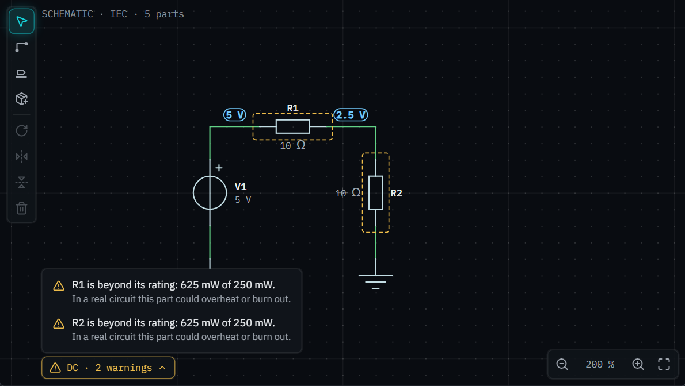

**Warnings (amber)** — the circuit is solved, but something deserves a look:

- *"R1 is beyond its rating: 625 mW of 250 mW."* — the resistor takes more power than its
  **Power rating** (Inspector). In a real circuit it would get too hot. The part gets an amber dashed
  outline. Use a larger resistance or a resistor with a higher rating.
- *"Pin 2 of R3 is not connected to anything."* — a loose pin. Normal while you are still drawing.

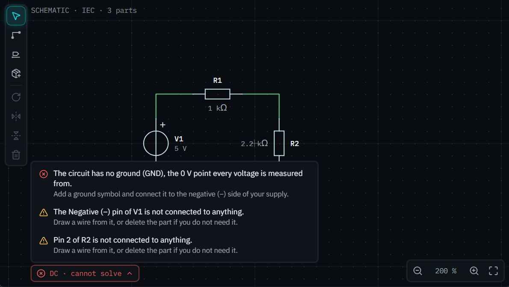

**Problems (red)** — the circuit cannot be solved as drawn. Nothing is calculated, the tags
disappear, the parts concerned get a red dashed outline, and the list explains what to do:

| Message | What it means | What to do |
|---|---|---|
| *The circuit has no ground (GND)…* | There is no 0 V point to measure from. | Place a **Ground** and connect it to the − side of your supply. |
| *R3 is not connected to ground, so its voltages cannot be worked out.* | A part or group of parts floats, connected to nothing that leads to ground. | Wire it into the circuit, or delete it. |
| *V1 and V2 are joined directly (in parallel or in a loop)…* | Two ideal supplies fight each other with nothing to limit the current. | Put a resistor between them, or remove one. |
| *Resistance of R1 must be more than 0 Ω.* | A value that is not possible. | Change it in the Inspector. |
| *The circuit around X1 … cannot be solved as drawn.* | The equations have no single answer (rare: the checks above catch almost everything). | Look at the parts named and how they are connected. |
| *This circuit is too big to solve yet…* / *The calculation took longer than 2 s…* | Very large circuits are supported in a later version. | Split the circuit; your drawing is never changed. |

Click a message in the list to **select the parts** it is about. Problems and warnings are also
written once to the **Console** when you stop editing for a moment (the most important one last, so
it is the one the status bar shows). When they are all fixed, the Console says *Circuit solved: all
problems fixed.*

**Good to know**

- An **open switch** is modelled like a real one: a very large resistance (1 GΩ), so a tiny leakage
  current (nanoamps) flows and the voltages after it are microvolts — practically zero. A closed
  switch is 1 mΩ.
- The **potentiometer's** *Wiper position* is measured from pin 1: at 25 % on a 5 V supply the wiper
  is at 3.75 V.
- **View → Show DC results** (or **Ctrl + K** → *Show DC results*) turns all of this off and on;
  your choice is remembered.
- Results are exact to far better than 0.1 % (checked against 22 textbook circuits).

# 9. If something goes wrong

RoboSim Studio tries hard never to leave you with a blank or frozen page.

| What you see | What it means | What to do |
|---|---|---|
| **A panel says "The … panel stopped working"** | Only that panel failed. The rest of the studio and your project are fine. | Click **Try again** in the panel. |
| **"The studio stopped working"** | The studio itself failed. Your projects are saved in this browser. | Click **Try again**, or **Reload the studio** (your projects open again; changes from the last second may be missing). |
| **"Something went wrong"** | Another page failed. | **Try again**, or go to the **Home page**. |
| **"Page not found"** | The address does not exist (for example a mistyped link). | **Open the studio** or go to the **Home page**. |

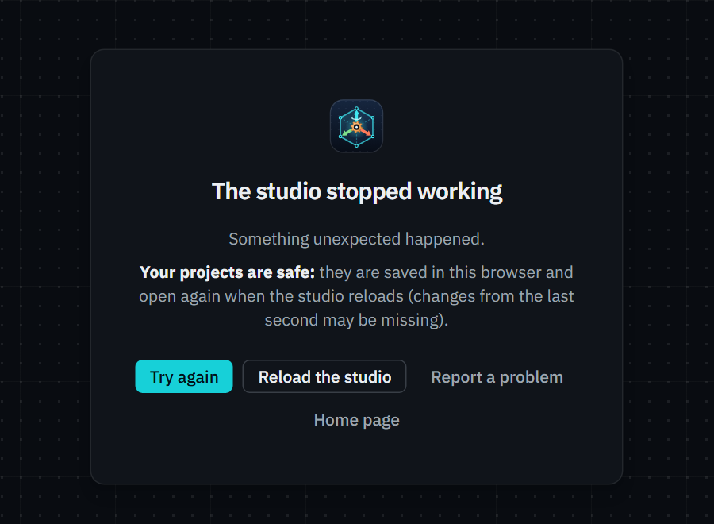

Every error screen has **Report a problem**, which opens a new issue on GitHub. If the screen shows
an **Error code**, include it in your report. The studio never shows or sends technical details
about your computer or your projects.

# Coming soon

These parts of the manual will be written as each feature is finished:

- One chapter for each of the 10 labs

# Version history of this manual

| Version | Date | Changes |
|---|---|---|
| 0.0.0 | 2026-11-21 | First edition: about RoboSim Studio, requirements, home page preview. |
| 0.0.0 · Day 05 | 2026-11-22 | New logo on the home page; chapters on themes, engineering number fields and the workspace (panels, toolbar, inspector). |
| 0.0.0 · Day 06 | 2026-11-22 | New chapter 7, the studio workspace: docking panels, saved layout, menus, project tabs, status bar, Low-end mode, command palette and keyboard shortcuts. Home page links to the studio. |
| 0.0.0 · Day 07 | 2026-11-23 | New section 7.4: project name in the Inspector, Undo / Redo (Edit menu, Ctrl + Z, Ctrl + Y). Shortcut table updated. |
| 0.0.0 · Day 08 | 2026-11-23 | New section 7.5: automatic saving, Recent projects, `.rsim` export / import and share links. Sections 7.6–7.8 renumbered; Alt + O added. |
| 0.0.0 · Day 09 | 2026-11-24 | New section 7.6: running a simulation (Run / Pause, Step, Stop, speed, live values, "Behind"). Sections 7.7–7.9 renumbered; simulation shortcuts added. |
| 0.0.0 · Day 10 | 2026-11-24 | Chapter 3 rewritten for the new home page; automatic Low-end mode and **System information** (7.7); Delete closes a project tab; new chapter 8, *If something goes wrong*. |
| 0.0.1 | 2026-11-24 | **First public release (v0.0.1).** Version numbers updated throughout; no other changes. |
| 0.0.1 · Day 12 | 2026-11-24 | New chapter 8, *Drawing a schematic*: zoom and pan, placing parts, selecting and editing, the Inspector, IEC / ANSI symbols and units. Canvas, Inspector and pointer position updated in chapter 7; *If something goes wrong* is now chapter 9. |
| 0.0.1 · Day 13 | 2026-11-25 | New sections 8.6–8.8: wires (wire tool, what connects), moving and editing wires (wires follow parts, the wire's net in the Inspector), net labels, copy / paste / duplicate. |
| 0.0.1 · Day 15 | 2026-11-26 | New section 8.9: live DC results — voltage tags on wires, voltage / current / power in the Inspector, the DC chip, warnings (power rating, loose pins) and problems with what to do, SPICE signs, switch and potentiometer notes, View → Show DC results. |
| 0.0.1 · Day 14 | 2026-11-26 | Section 8.2 rewritten: the **Parts** panel (search, search by value, drag and drop, Add part, recently used) and the list of parts, with the new potentiometer and switch. Section 8.4: every property in the Inspector, editing several parts at once. Tool palette, window parts and shortcuts (Alt + 5, A) updated. |
