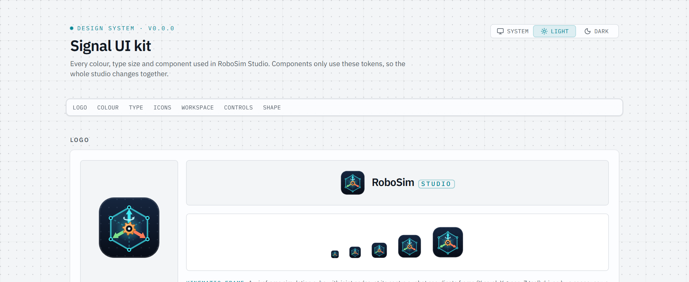

# About this manual

This manual explains **what every screen, button and tool in RoboSim Studio does and how to use it**.
It grows together with the software: each feature is added here on the Day it is built and tested.

- **Software version covered:** v0.0.0 (Phase 0 — Foundation)
- **Last updated:** 2026-11-22 (Day 05)
- Features that are not built yet are listed under *Coming soon* and are not described in detail.

# 1. What is RoboSim Studio?

RoboSim Studio is a free, open-source robotics lab that runs in your web browser. When it is complete,
you will be able to design circuits, program Arduino, ESP32 and Raspberry Pi Pico boards, model sensors
and motors, tune controllers, simulate power electronics, drive robots in 2D and 3D, learn ROS 2, and
move simulated or real robots with your own hand gestures — with no installation and no licence fees.

It is organised into **10 labs** plus a learning platform:

| # | Lab | What it is for | Available from |
|---|---|---|---|
| 1 | Circuit Lab | Build and measure electronic circuits | v0.1 |
| 2 | Microcontroller Lab | Program Arduino and Raspberry Pi Pico boards | v0.2 |
| 3 | IoT Lab | ESP32 with Wi-Fi, MQTT and Bluetooth | v0.3 |
| 4 | Sensors & Actuators Lab | Realistic sensors, motors and drivers | v0.4 |
| 5 | 2D Robotics Lab | Mobile robots in 2D worlds | v0.5 |
| 6 | Control Systems Lab | PID, Bode plots, state-space control | v0.6 |
| 7 | Power Electronics Lab | Converters, solar MPPT, batteries | v0.6 |
| 8 | 3D Robotics Lab | Robot arms, rovers and drones in 3D | v0.7 |
| 9 | ROS Lab | ROS 2 concepts, navigation and SLAM | v0.8 |
| 10 | Gesture Control Lab | Move robots with hand and body gestures from a webcam | v0.9 |

# 2. Getting started

## 2.1 What you need

| Item | Requirement |
|---|---|
| Computer | Desktop or laptop (phones and tablets are not supported) |
| Memory | 8 GB RAM or more |
| Browser | Latest Chrome or Edge (recommended), Firefox or Safari |
| Screen | 1366 × 768 or larger, with keyboard and mouse or touchpad |
| Internet | Needed for the first load; loaded labs keep working offline |

## 2.2 Opening RoboSim Studio

The public website address will be added here when the first version is online (v0.0.1).

**During development (on the developer's computer):** open your browser and go to
`http://localhost:3100`.

# 3. Home page

The home page is the first screen you see. In v0.0.0 it is a **preview page** that confirms the
software is running. It will be replaced by the full studio workspace on Day 06.

| Part of the screen | What it does |
|---|---|
| **Logo** (cube with X/Y/Z arrows and a copper gear) | The RoboSim Studio logo — a robot's coordinate frame and servo joint inside a 3D simulation world. The same picture is the icon in your browser tab. |
| **RoboSim Studio** title | Shows the name of the software. |
| **Primary button**, **Outline button** | Style preview only — they do not perform any action yet. |
| Grid of 10 labs | Lists the labs in release order (P1 = phase 1, and so on). Not clickable yet. |
| Footer line | Shows the software version and the current development phase. |

# 4. Appearance: light and dark themes

RoboSim Studio has a **dark** theme (the default — easier on the eyes during long sessions and it makes
circuits and plots stand out) and a **light** theme (good for classrooms, projectors and printing).

**How to change the theme**

1. Find the **SYSTEM · LIGHT · DARK** switch (top right of the page).
2. Click **LIGHT** or **DARK**. The whole page changes at once.
3. Click **SYSTEM** to follow your computer's own light/dark setting automatically.

| Option | What happens |
|---|---|
| **System** | Uses your operating system's setting and follows it if it changes. |
| **Light** | Light grey workspace with white panels. |
| **Dark** | Deep graphite workspace with a teal accent (default). |

- Your choice is **remembered** on this computer and browser, even after closing it.
- **Keyboard:** press **Tab** to reach the switch, then **←** / **→** to change the theme.

# 5. Entering values (engineering number fields)

Wherever you set a value with a unit — resistance, voltage, frequency, capacitance — RoboSim Studio
uses an **engineering number field**. You can type values the way engineers write them.

**Typing a value**

1. Click in the field and type the value, e.g. `4.7k`.
2. Press **Enter** (or click somewhere else). The field shows it neatly as **4.7 k** and the unit (Ω).
3. Everything that depends on the value updates immediately (in the example, the current).

**SI prefixes you can type**

| Type | Means | Example | Value |
|---|---|---|---|
| `p` | pico, × 10⁻¹² | `22p` | 22 pF |
| `n` | nano, × 10⁻⁹ | `100n` | 100 nF |
| `u` or `µ` | micro, × 10⁻⁶ | `4.7u` | 4.7 µF |
| `m` | milli, × 10⁻³ | `20m` | 20 mA |
| `k` | kilo, × 10³ | `4.7k` | 4 700 Ω |
| `M` or `meg` | mega, × 10⁶ | `1M` | 1 000 000 Ω |
| `G` | giga, × 10⁹ | `2.4G` | 2.4 GHz |

Small **m** is milli and capital **M** is mega. Normal numbers (`220`, `3.3`) and scientific notation
(`2.2e-6`) also work.

**Keys**

| Key | Action |
|---|---|
| **↑** / **↓** | Increase / decrease by one step |
| **Shift** + **↑** / **↓** | Change by ten steps |
| **Enter** | Accept the typed value |
| **Esc** | Cancel typing and go back to the previous value |

The small **▲ / ▼** buttons on the right of the field do the same as the arrow keys.

**If you type something that is not a number** (for example `abc`), the field turns **red** and the
old value is kept, so a wrong entry can never break a simulation. Correct the text or press **Esc**.

# 6. The workspace: panels, toolbar and inspector

RoboSim Studio's labs are built from three kinds of building blocks. In v0.0.0 you can try them in a
small LED-circuit preview on the UI kit page (`/ui-kit` → **Workspace**); the full studio arrives on Day 06.

**Panels** are the boxes that hold each tool (parts list, inspector, oscilloscope…).

| Part of a panel | What it does |
|---|---|
| Title bar | Panel name in capitals, with an icon. A small grey number or text next to it gives extra info (e.g. how many parts). |
| Buttons on the right of the title bar | Actions for that panel, e.g. **+** to add a part. |
| Bottom line | Status of the panel, e.g. the current tool, grid size and number of warnings. |

**The toolbar** sits above the canvas.

| Control | What it does |
|---|---|
| **Select / Wire / Pan** (arrow, curve, hand) | Choose the mouse tool. Only one can be active; it lights up in teal. |
| **Run / Pause** (▶ / ⏸) | Start or pause the simulation. While running, the badge shows **LIVE** with a blinking light and current flows along the wires. |
| **Step** (▷|) | Advance the simulation by one step (when paused). |
| **Reset** (↺) | Return to the starting values. |
| **Zoom − / +** and the % value | Zoom the canvas out or in. |

- **Hover** over any tool to see its name and keyboard shortcut (e.g. **Wire W**).
- **Keyboard:** press **Tab** to enter the toolbar, then use **←** / **→** to move between tools and
  **Enter** to use one.

**The inspector** shows the properties of the selected part.

1. Click a part in the **Parts** panel or on the canvas — it is highlighted with a dashed teal frame.
2. Change its properties in the **Inspector** (name, value, rating, position, rotation, label).
3. Click a section title (**▸ COMPONENT**, **▸ TRANSFORM**…) to fold or unfold it.
4. The **Live simulation** section shows results in teal (current, voltage, power). If a value is
   dangerous — for example a resistor's power is above its rating — it turns **red** and the canvas
   status line shows a **warning**. This teaches the safe limits of real parts.

# Coming soon

These parts of the manual will be written as each feature is finished:

- Studio workspace: docking panels, project tabs, command palette (**Ctrl + K**) and all keyboard
  shortcuts (Day 06)
- Saving, opening, exporting and sharing projects (Days 07–08)
- Simulation controls in the real studio: play, pause, step and speed (Day 09)
- Low-end mode for slower computers (Day 10)
- One chapter for each of the 10 labs

# Version history of this manual

| Version | Date | Changes |
|---|---|---|
| 0.0.0 | 2026-11-21 | First edition: about RoboSim Studio, requirements, home page preview. |
| 0.0.0 · Day 05 | 2026-11-22 | New logo on the home page; chapters on themes, engineering number fields and the workspace (panels, toolbar, inspector). |
